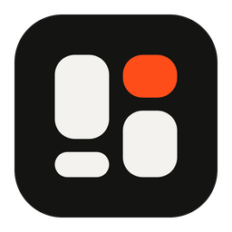
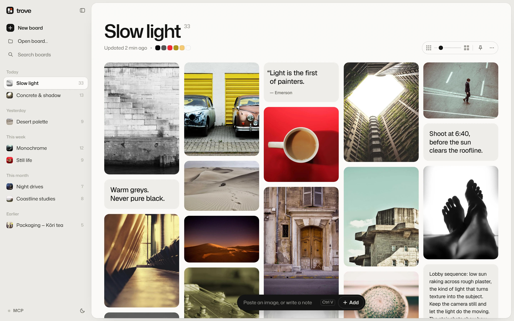
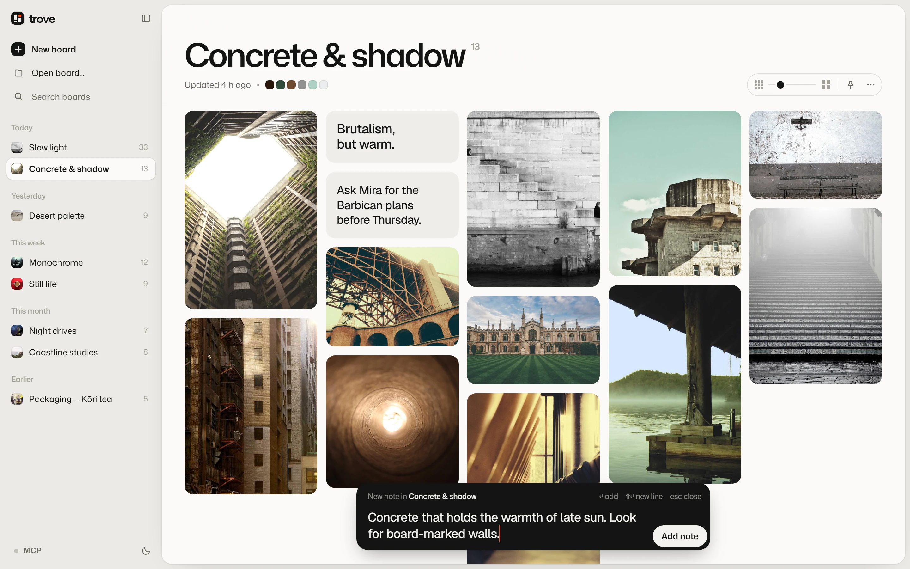
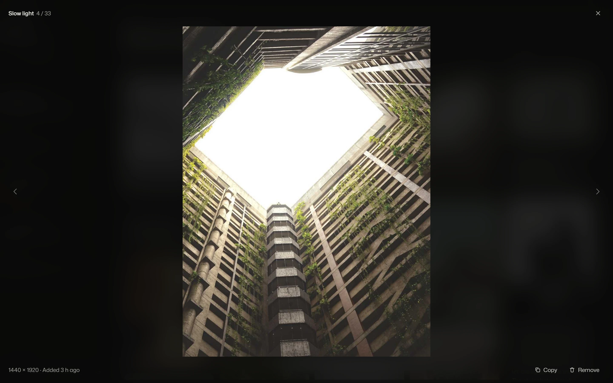
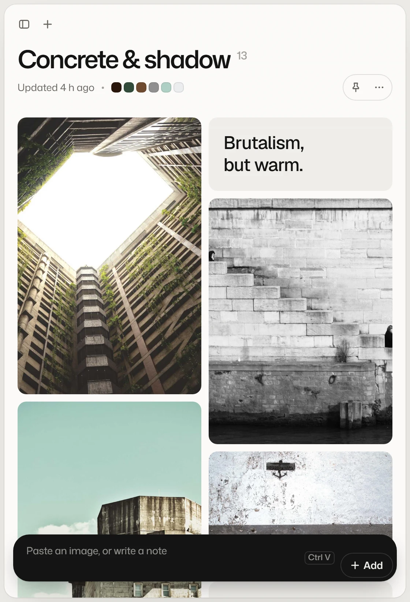
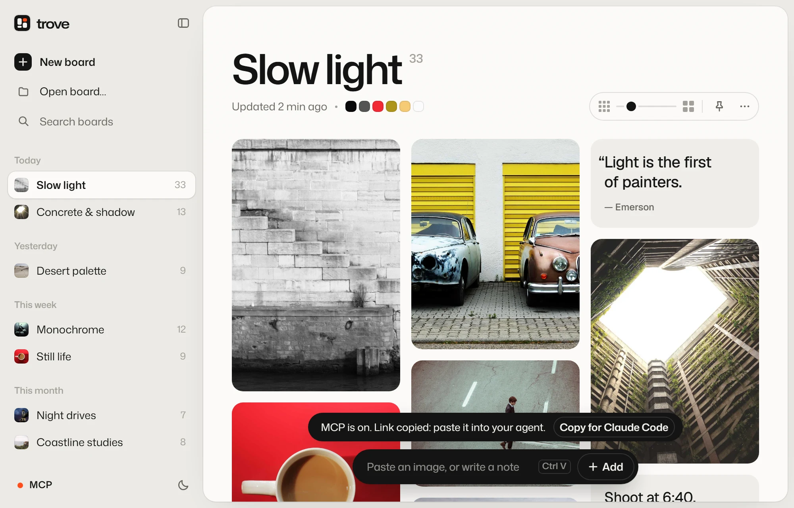

<p align="center">
  
</p>

<h1 align="center">Trove</h1>

<p align="center">
  A desktop app for collecting visual references and ideas.<br>
  Paste images, links and notes onto boards, and keep them next to whatever you're working on.
</p>

<picture>
  <source media="(prefers-color-scheme: dark)" srcset="docs/screenshots/board-dark.webp">
  
</picture>

Trove is for designers, artists and anyone who gathers references while they work. Paste a screenshot, drop in files, paste a link, or just start typing, and it lands on the board. Each board is a single `.trv` file on your computer, with every image stored inside it. There's no account and no cloud, and it works offline.

## Features

- **Paste anything.** Images, screenshots, image links and files go straight onto the board. Images are copied into the board's file, so a `.trv` file is self-contained and you can move it, back it up or send it to someone.
- **Notes are cards too.** Type anywhere on a board and press Enter. Notes sit in the grid next to the images, set large when they're short and as body text when they're long. Click one to edit it.
- **A calm masonry grid.** Cards keep their shape while images load, filled with each image's average colour. A slider sets the column width, and the header shows the board's colour palette (click a swatch to copy its hex value).
- **Focus view.** Open any card on its own and step through the board with the arrow keys.
- **Boards are files.** Name a board whatever you like, independently of its file name. The sidebar keeps every board you've opened, grouped by when it last changed. Drag a card onto another board to move it there.
- **Stays out of the way.** Keep the window on top of other apps, shrink it down beside your work, and do almost everything from the keyboard. Light and dark themes.
- **Readable by AI agents.** Turn on Trove's built-in [MCP](https://modelcontextprotocol.io) server and coding agents like Claude Code, Cursor or VS Code can read your boards, notes and images while they work.

### Notes

Start typing anywhere on a board. The composer previews the note as you write it, and Enter adds it as a card. A note whose last line starts with "—" is shown as a quote.



### Focus view

Click an image, or hover it and press Space, to see it on its own. The footer shows its size, when you added it and where it came from.



### Next to your work

Trove adapts to small windows: the sidebar tucks away and the grid reflows. Press `Ctrl Shift A` to keep it on top while you work in another app.



### AI agents

Click **MCP** at the bottom of the sidebar to let a coding agent read your boards. See [Connecting AI agents](#connecting-ai-agents-mcp).



## Building from source

You'll need:

- [Bun](https://bun.sh)
- [Rust](https://www.rust-lang.org/tools/install) and the other [Tauri prerequisites](https://v2.tauri.app/start/prerequisites/) for your OS (WebView2 on Windows, which Windows 10 and 11 usually already have)

Clone this repository, then from its folder:

```sh
bun install              # installs the Tauri CLI
bun run tauri dev        # runs Trove in development
bun run tauri build      # builds the installers
```

The installers end up in `src-tauri/target/release/bundle/`. Installing Trove registers the `.trv` file type, so you can double-click board files to open them. In development, use **Open board…** (`Ctrl O`) instead.

## Using Trove

- **New board** (`Ctrl N`) starts a board with its title ready to type. **Save** (`Ctrl S`) asks where to put the file the first time.
- **Add things** by pasting (`Ctrl V`), dropping files or links, using the file picker, or typing a note. If a site won't let Trove download a pasted image, it's kept as a web link and needs a connection to show.
- **Rename** a board by clicking its title. The name is stored inside the file, so `references.trv` can hold a board called Portfolio Site.
- **Reorder** cards by dragging them. **Move** a card to another board by dragging it onto that board in the sidebar.
- **Remove** a card with `Delete`, and bring it back with `Ctrl Z`.
- **Delete a board** from the `···` menu. Its file goes to the Recycle Bin (Trash on macOS and Linux), so you can restore it.
- If closing Trove or switching boards would lose unsaved changes, Trove asks first. It reopens your last board when it starts.

### Keyboard shortcuts

On macOS, use Cmd instead of Ctrl.

| Shortcut            | Action                                                                  |
| ------------------- | ----------------------------------------------------------------------- |
| `Ctrl N`            | New board                                                               |
| `Ctrl O`            | Open a board file                                                       |
| `Ctrl S`            | Save the board                                                          |
| `Ctrl Shift S`      | Save the board under a new name                                         |
| `Ctrl V`            | Paste an image or link into the board                                   |
| Any letter          | Start a note (`Enter` adds it, `Shift Enter` adds a line, `Esc` closes) |
| `Ctrl K`            | Search boards                                                           |
| `Ctrl B`            | Show or hide the sidebar                                                |
| `Ctrl Shift A`      | Keep the window on top                                                  |
| `Ctrl =` / `Ctrl -` | Bigger / smaller cards                                                  |
| `Ctrl Z`            | Restore the last removed card                                           |
| `Space`             | Open the hovered card in focus view (`Space` or `Esc` closes it)        |
| `Enter`             | Edit the hovered note (`Enter` or `Esc` finishes)                       |
| `←` / `→`           | Previous / next card in focus view                                      |
| `Delete`            | Remove the hovered or focused card                                      |
| `Ctrl C`            | Copy the hovered image or note                                          |
| `Esc`               | Close a menu or focus view, or cancel a drag                            |

## Connecting AI agents (MCP)

Trove can run a small, read-only [MCP](https://modelcontextprotocol.io) server so a coding agent (Claude Code, Cursor, VS Code, or any other MCP client) can use your references while it works: the notes in full, each image's size, colour and source link, and the images themselves.

Click **MCP** at the bottom of the sidebar. It turns on and copies a link, which you paste into your agent. The message that appears also offers a ready-made Claude Code command. Click **MCP** again to turn it off.

```sh
# Claude Code
claude mcp add --transport http trove http://127.0.0.1:8768/mcp/<secret>
```

```json
{
  "mcpServers": {
    "trove": { "type": "http", "url": "http://127.0.0.1:8768/mcp/<secret>" }
  }
}
```

Agents get four tools:

| Tool          | What it returns                                                                                             |
| ------------- | ----------------------------------------------------------------------------------------------------------- |
| `list_boards` | The open board (including unsaved changes) and every saved board in the sidebar, with note and image counts |
| `get_board`   | One board in order: every note's text, and each image's id, size, dominant colour, source link and date     |
| `get_image`   | One image, scaled down to 1568px on its long edge by default (`max_size` changes that)                      |
| `search`      | Notes and image links containing some text, across all boards or one                                        |

- **Private by default.** The server only listens on your own computer (`127.0.0.1`), only answers on the secret link, and turns away requests from web pages.
- **Read-only.** Agents can't change, add or delete anything.
- **Stays on.** Trove remembers the setting and the link and starts the server again next time. If port 8768 is taken, it picks a free port and copies the new link.
- **Transport:** MCP's Streamable HTTP, answering with plain JSON (no server-sent events). Protocol versions 2025-06-18, 2025-03-26 and 2024-11-05. The code is in [src-tauri/src/mcp.rs](src-tauri/src/mcp.rs).

## Privacy

Your boards stay on your computer. Trove has no account, no analytics and no telemetry. It only goes online to download images from links you paste, and to show images you've kept as web links. The MCP server is off until you turn it on, and only accepts connections from your own computer.

## The .trv format

A `.trv` file is one board, stored as a zip archive:

```text
project.json        the board's cards and their details
images/<id>.<ext>   every image on the board, in its original format
```

`project.json` looks like this:

```json
{
  "format": "trove",
  "version": 2,
  "name": "Portfolio Site",
  "createdAt": 1795990000000,
  "updatedAt": 1795996000000,
  "savedAt": 1795996800000,
  "items": [
    {
      "id": "p0q8r7st",
      "file": "p0q8r7st.png",
      "w": 1600,
      "h": 1200,
      "color": "rgb(182, 140, 101)",
      "tone": [201, 132, 74],
      "createdAt": 1795995000000,
      "pos": 1795995000000
    },
    {
      "id": "n4m2k8qa",
      "kind": "text",
      "text": "Warm greys. Never pure black.",
      "createdAt": 1795995600000,
      "pos": 1795995600000
    }
  ]
}
```

- `name` is the board's name, independent of the file name. Files without one are named after the file.
- `file` names an image inside `images/`. Images kept as web links have `src` (their address) instead.
- Notes have `"kind": "text"` and their words in `text`.
- `color` is an image's average colour, shown while it loads. `tone` is its dominant colour, used for the board's palette.
- `pos` sets the order on the board, highest first.
- Trove refuses files whose `format` isn't `"trove"`, and files with a newer `version` than it understands. Version 1 files, which held several boards, open as one board with all their cards.

While a board is open, its images sit unpacked in a working folder in the app's cache directory (`%LOCALAPPDATA%\com.absideon.trove\sessions\` on Windows). Saving packs them back into the `.trv`. Trove writes to a temporary file first and then swaps it in, so a failed save can't damage the existing file.

## Development

Trove is built with [Tauri 2](https://v2.tauri.app). The interface is plain HTML, CSS and JavaScript with no build step or framework. The backend is Rust.

```text
src/                     the interface, served as-is
  index.html, styles.css, main.js
  fonts/                 Mona Sans and Geist, bundled so Trove works offline
src-tauri/
  src/lib.rs             the commands the interface calls, and app setup
  src/project.rs         reading and writing .trv files
  src/mcp.rs             the MCP server
  src/platform.rs        tells the interface which OS it's on
  capabilities/          which Tauri APIs the interface may use
docs/                    design notes and screenshots
```

```sh
cd src-tauri && cargo test    # file format and MCP server tests
```

[docs/design.md](docs/design.md) covers the visual design, what Trove borrows from Pinterest and PureRef, and how it uses Tauri.

Recommended editor setup: [VS Code](https://code.visualstudio.com/) with the [Tauri](https://marketplace.visualstudio.com/items?itemName=tauri-apps.tauri-vscode) and [rust-analyzer](https://marketplace.visualstudio.com/items?itemName=rust-lang.rust-analyzer) extensions.

## Roadmap

- **Canvas view:** a freeform surface for placing, scaling and comparing references while you work, alongside today's grid.
- **Tags and search** across every board.
- **Overlay mode:** a frameless window with adjustable opacity and click-through, for keeping references on top of another app.
- **Faster big boards:** only render the cards in view.

## Acknowledgements

- Inspired by [Pinterest](https://www.pinterest.com) for collecting and browsing, and [PureRef](https://www.pureref.com) for working with references.
- Interface type is [Mona Sans](https://github.com/github/mona-sans) by GitHub, and notes are set in [Geist](https://github.com/vercel/geist-font) by Vercel, both under the SIL Open Font License.
- The photos in the screenshots are from [Unsplash](https://unsplash.com), via [Lorem Picsum](https://picsum.photos).
